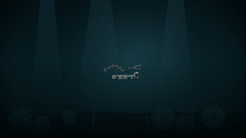

# Story-to-Animation Video Agent

**English** | [简体中文](README.zh-CN.md)

Turn a UTF-8 story into an animated video through story analysis, storyboarding, frame planning, Canvas animation, and visual and temporal reviews. Chromium renders the frames and FFmpeg assembles the video. The pipeline publishes `final.mp4` only after final acceptance. Interrupted or rejected candidates are retained so you can continue with `--resume`.

The default output is **20 seconds, 24 fps, 1280×720, H.264 MP4, without audio**. The current rendering backend uses procedural Canvas animation; image generation models, voiceovers, and subtitle tracks are not integrated.

## Video Showcase

All four videos below completed this project's generation and final acceptance workflow. The README displays smaller animated GIF previews. Click a preview or **Full MP4** to open the original **1280×720, 24 fps video without audio**.

| Mechanical Underwater World · 20 seconds | A Little Cloud's Rainbow Sneeze · 6 seconds |
| --- | --- |
| [](docs/showcase/sea_world.mp4) | [](docs/showcase/cloud_sneeze.mp4) |
| Old tools, chains, and metal parts assemble into a mechanical fish swimming through a dark underwater world. | A little cloud sneezes out a red, yellow, and blue rainbow. |
| [Full MP4](docs/showcase/sea_world.mp4) · [Original story](story_sea.txt) | [Full MP4](docs/showcase/cloud_sneeze.mp4) · [Original story](examples/stories/cloud_sneeze.txt) |

| A Balloon Takes a Star Home · 6 seconds | The Cookie Escape · 6 seconds |
| --- | --- |
| [](docs/showcase/balloon_star.mp4) | [](docs/showcase/cookie_escape.mp4) |
| A red balloon carries a little star into the night sky. The star stops and gives a happy blink. | A chocolate chip cookie tiptoes away from its jar, then stops with a proud grin. |
| [Full MP4](docs/showcase/balloon_star.mp4) · [Original story](examples/stories/balloon_star.txt) | [Full MP4](docs/showcase/cookie_escape.mp4) · [Original story](examples/stories/cookie_escape.txt) |

The underwater video was copied from the existing `sea_video/final.mp4`; its SHA-256 matches the original accepted video. The three new stories are in `examples/stories/`. Video specifications, source paths, and acceptance status are recorded in [`docs/showcase/provenance.json`](docs/showcase/provenance.json). The original story files are in Chinese.

<details>
<summary>Commands to generate the three new stories</summary>

Install the environment and configure `.env` as described below, then run these commands from the project root:

```bash
conda activate vagent

for story in cloud_sneeze balloon_star cookie_escape; do
  LLM_EXTRA_BODY='{"thinking":{"type":"disabled"},"max_tokens":32768}' \
  python -m agent generate "examples/stories/${story}.txt" \
    --out "outputs/showcase/${story}" --seconds 6 --fps 24 \
    --max-calls 120 --max-seconds 3600
done
```

These are the model settings used for the new examples. They do not modify the root `.env` file; adjust them to match your provider's supported parameters. A new output directory must be empty. To continue a paused story, use the same parameters and add `--resume`. Some shots in these examples required local code repairs and higher task-specific candidate limits before passing review; see `provenance.json` for repair records. Model output and repair counts can vary between runs, so regeneration does not guarantee identical pixels.

</details>

## 1. Environment Setup

Run the following Bash / Zsh commands from the project root. If you already cloned the repository, enter your existing checkout instead of cloning it again.

```bash
git clone https://github.com/wflying000/frame_video_agent.git
cd frame_video_agent
```

### 1.1 Create a Python environment

With Conda already installed, create a Python 3.10 environment:

```bash
conda create -n vagent python=3.10 -y
conda activate vagent
python -m pip install -r requirements.txt
```

The project has been verified with Python 3.10.22. Its Python dependencies are `playwright==1.51.0` and `python-dotenv>=1.0.0`; [`requirements.txt`](requirements.txt) is the source of truth.

If Python 3.10 is already installed, you can use a standard virtual environment instead of Conda:

```bash
python3.10 -m venv .venv
source .venv/bin/activate
python -m pip install -r requirements.txt
```

### 1.2 Install Chromium and FFmpeg

On macOS, with Homebrew already installed:

```bash
python -m playwright install chromium --only-shell
brew install ffmpeg
```

On Ubuntu / Debian:

```bash
sudo apt-get update
sudo apt-get install -y ffmpeg
python -m playwright install --with-deps chromium --only-shell
```

Playwright's Chromium must be installed separately; `pip install` alone does not install the browser. On Linux, `--with-deps` installs the browser's system dependencies and may require administrator privileges. Both `ffmpeg` and `ffprobe` must be on your `PATH`.

Check the environment:

```bash
python --version
python -m playwright --version
ffmpeg -version
ffprobe -version
python -m agent --help
```

After installation, you can use the offline rendering commands in Section 7 to verify the browser and encoder without a model API key.

## 2. Model Configuration

Create `.env` from the template in the project root. If `.env` already exists, edit it directly and preserve your existing settings:

```bash
test -f .env || cp .env.example .env
```

The template uses the provider URL and model name built into the application:

```dotenv
LLM_API_KEY=your-deepseek-api-key
LLM_BASE_URL=https://api.deepseek.com
LLM_MODEL=deepseek-flash
LLM_EXTRA_BODY='{"thinking":{"type":"disabled"}}'
```

Replace `LLM_API_KEY` with your own key and configure `LLM_BASE_URL`, `LLM_MODEL`, and `LLM_EXTRA_BODY` for your provider. The template values do not guarantee that your account has access to that model. Generation and review share one model, which must support **Chat Completions, JSON object output, and actual multi-image input**. A text-only model cannot perform visual review.

| Setting | Description |
| --- | --- |
| `LLM_API_KEY` | API key. If unset, the application checks `DEEPSEEK_API_KEY`, then `DASHSCOPE_API_KEY`. |
| `LLM_BASE_URL` | API base URL. The application appends `/chat/completions`; do not supply the full endpoint or an `/anthropic` protocol URL. |
| `LLM_MODEL` | A multimodal model ID supported by your provider. |
| `LLM_EXTRA_BODY` | A JSON object merged into the request body. It can override parameters such as `max_tokens` and `stream`; provider-specific fields must be supported by your service. |
| `LLM_IDLE_TIMEOUT_SECONDS` | Timeout without new content or reasoning text, in seconds. Defaults to `180`; must be a finite positive number. |
| `LLM_SHOW_OUTPUT` | Set to `1` to stream the complete model response to the terminal, equivalent to `--show-model-output`. |

Default request parameters are `temperature=0.2`, `max_tokens=12000`, `response_format={"type":"json_object"}`, and `stream=true`. If another provider does not support the template's `thinking` field, set `LLM_EXTRA_BODY` to `'{}'`. If streaming is unsupported, use `'{"stream":false}'`. For truncated output, adjust `max_tokens` or reasoning settings within your provider's limits.

Keep `.env` in the project root, not inside `agent/`. Existing process environment variables take precedence over `.env`. Rendering-only subprocesses do not read `.env`. Real keys and local generation outputs are excluded by `.gitignore`.

The terminal displays stage progress and model waiting status. Each call saves `request.json`, `response.txt`, and `response.json` under the candidate's `calls/<call-name>/<cumulative-call-number>/` directory. Request logs represent images by hashes, and configured keys are redacted from responses. A response-format error receives at most one correction attempt within the same candidate; if it still fails, the project pauses with its progress saved.

## 3. Generate Videos

In each new terminal, activate your Python environment and enter the project root:

```bash
conda activate vagent
# If using .venv, run source .venv/bin/activate instead.
```

### 3.1 Generate a short example

The repository includes [`examples/story.txt`](examples/story.txt): a small red ball moves from left to right and stops. Use it to verify the complete generation workflow:

```bash
python -m agent generate examples/story.txt \
  --out outputs/red_ball --seconds 4 --fps 24 \
  --show-model-output
```

On success, the output is **`outputs/red_ball/final.mp4`**. Generation makes multiple model calls; time and cost depend on the storyboard, reviews, and repair attempts. Completing only some shots or failing a required review does not publish `final.mp4`.

### 3.2 Generate the underwater story or your own story

Use the included [`story_sea.txt`](story_sea.txt):

```bash
python -m agent generate story_sea.txt \
  --out outputs/sea_video --seconds 20 --fps 24 \
  --show-model-output
```

On success, the output is `outputs/sea_video/final.mp4`. This command uses a new `outputs/sea_video/` directory, which can coexist with the historical local `sea_video/` directory.

Save your own story as a UTF-8 text file, such as `my_story.txt`, then run:

```bash
python -m agent generate my_story.txt \
  --out outputs/my_story --seconds 20 --fps 24
```

The file entry point `python agent/video_agent.py generate ...` is also supported. The default output directory is `output/`; explicitly setting `--out outputs/<project-name>` is recommended. A first run requires a nonexistent or empty output directory. Use a new directory when changing the story, duration, or frame rate.

### 3.3 Resume and manage budgets

Resume with the same story, output directory, duration, frame rate, and model configuration:

```bash
python -m agent generate examples/story.txt \
  --out outputs/red_ball --seconds 4 --fps 24 --resume
```

If the cumulative budget is exhausted, explicitly increase the limits and resume:

```bash
python -m agent generate examples/story.txt \
  --out outputs/red_ball --seconds 4 --fps 24 --resume \
  --max-calls 180 --max-seconds 5400
```

`--resume` reuses passed tasks whose hashes remain valid. It does not reset candidate counts, model calls, or active elapsed time. Legacy directories without the current `manifest.json` cannot be resumed directly. See Section 5 for candidate limits and local repairs.

### 3.4 Common CLI options

| Option | Default | Description |
| --- | --- | --- |
| `generate <story.txt>` | — | Read a story and run model generation and review. |
| `render <animation.html>` | — | Render existing Canvas HTML offline, without an API key. |
| `--out` | `output` | Output directory; a new task requires a nonexistent or empty directory. |
| `--seconds` | `20` | Integer duration in seconds, from `2` to `120`. |
| `--fps` | `24` | Integer frame rate, from `1` to `60`. |
| `--resume` | Off | Resume an existing task; available only for `generate`. |
| `--max-calls` | `120` | Cumulative model-call limit for the entire project; must be positive. |
| `--max-seconds` | `3600` | Cumulative active-time limit; must be positive. It is not a strict wall-clock deadline. |
| `--task-attempt-limit TASK=COUNT` | Per task type | Increase a task's cumulative candidate limit; only for `generate --resume`. May be repeated. |
| `--show-model-output` | Off | Print the complete model response. |
| `--preview` | Off | Generate sampled PNG previews without encoding an MP4; only for `render`. |

Resolution is fixed at 1280×720; there are currently no width or height CLI options. A failed or paused generation exits with a nonzero status. See the terminal, `manifest.json`, and candidate review records for details.

## 4. Generation Workflow

1. **Story facts and causality:** Extract entities, events, source evidence, before/after states, and the ending. A separate model call reviews fidelity to the original story.
2. **Visual design and storyboard:** Define fixed assets and variable states. Validate event coverage, ordering, continuous integer frame ranges, and total frame count before drawing.
3. **Reference assets and written pacing review:** Draw and review each character, prop, and setting reference. Review the complete written storyboard for shot order, duration, pacing, and state transitions, and save `plans/pacing.txt`. This stage no longer creates text-placeholder PNGs, HTML, or `animatic.mp4`; later visual reviews verify the actual motion.
4. **Per-shot frame plans:** Plan entry and exit states, contact points, state changes, keyframes, and motion intervals. Keyframes must cover every hard shot requirement. Timelines use zero-based integer frames and half-open intervals.
5. **Individual shots and keyframe acceptance:** Generate deterministic Canvas code for each shot. Render and review the anchor frame first, then the remaining keyframes. Reviews receive actual reference images, the current frame, and preceding frames where needed.
6. **Local repair and temporal review:** Prefer patching the current shot's code, then recheck the entire shot. Samples cover keyframes, neighborhoods around contact and state changes, shot boundaries, and ordinary intervals. Review motion, causality, contact, and identity continuity.
7. **Shot export and boundary review:** Reload the animation and verify that previews remain identical, render PNG frames, and encode each shot. Then independently review continuity between adjacent shots.
8. **Composition and final acceptance:** Concatenate shots in timeline order. Check decoded dimensions, frame rate, frame count, timestamps, and undeclared black frames. Sample the encoded video, first collect independent observations without the story, then compare each event with the original and record evidence frames. Publish `final.mp4` only when all required tasks pass and their versions remain valid.

Review statuses are `PASS / FAIL / UNCERTAIN / NOT_APPLICABLE`. Missing checks, version mismatches, and `UNCERTAIN` or `NOT_APPLICABLE` on hard requirements prevent acceptance. A visual `PASS` must cite frame indices actually supplied to that review.

## 5. Local Repairs, Versions, and Recovery

Each task stores candidates in separate `v001/`, `v002/`, and subsequent version directories. Reviews are bound to a target ID and version. The manifest records input hashes, dependency versions, output hashes, candidate counts, and model-call counts.

A shot has a default limit of five candidates. After a failure, repairs continue from the latest saved `scene.html` and its valid frame plan. Reaching the fourth or fifth attempt does not automatically trigger a complete redraw. Replanning happens only when a review explicitly identifies a planning error. If a patch fails, the pipeline falls back to the latest candidate containing actual code, rather than treating patch JSON as a complete scene. Planning and asset tasks default to three candidates. Final acceptance can trigger at most two rounds of repairs to identified shots. Restarting or switching candidates does not reset retry or whole-video repair counts. Network errors receive at most one retry, after which the candidate and completed calls are retained for recovery.

Streaming calls time out after 180 seconds without new content or reasoning text by default. SSE keepalives, empty deltas, and usage events do not reset this timer. Set `LLM_IDLE_TIMEOUT_SECONDS` to a finite positive value to change it. Reading stops when a finish reason arrives, without waiting for the server to close the connection. A timeout preserves partial output and diagnostics and allows at most one retry within the same candidate. Consecutive timeouts pause the project for `--resume` without consuming a new visual candidate.

HTTP 429 and 5xx responses receive at most one retry after a delay of at least five seconds. A longer numeric `Retry-After` value is respected; if it exceeds 30 seconds, the pipeline saves progress and asks you to resume later. Consecutive service errors pause the project explicitly. Passed reviews and generated code remain reusable, and resuming does not consume another candidate for the interrupted work.

Local repairs receive both the original full frames and actual enlarged crops of failed regions, with source frame indices, region coordinates, and hashes. A new shot can build on the preceding accepted shot's code and final frame to reduce changes in character design and background. Every repair still triggers a review of all keyframes, motion, and adjacent boundaries; enlarged crops do not replace full-frame acceptance. Candidate directories preserve `repair_strategy.json`, `repair_evidence/`, or `continuity_reference.json` to document the repair evidence.

A repair request selects at most six actual frames from each failure report, with at most two enlarged regions per frame. The full original review is retained. This bounds repeated image input. A shot's temporal review checks whether its exit state matches the next shot's approved entry plan; it does not request images from a shot that has not yet been generated. After all shots are complete, a separate boundary review must still pass using actual frames from both sides.

Boundary reviews account for camera position and framing in both storyboard entries, distinguishing planned viewpoint changes from unexplained story-state changes. A cut does not require identical screen coordinates, scale, or front/back views. Character identity, open/closed object states, and action outcomes must remain continuous.

Boundary reviews extract three consecutive frames immediately next to each cut from both encoded shots and record pixel changes across the cut and neighboring frames. Motion-phase checks prevent camera descriptions from excusing sudden body deformation, head extension, tail resets, or disappearing backgrounds. Pixel-change measurements help locate issues but do not replace visual review. Boundary repair requests receive the preceding shot's actual HTML, final frame time, and next sample time so local `t=0` continues the motion. Crossfading two complete bodies to hide a discontinuity is prohibited. Older boundary reviews require revalidation; shot history and previously delivered videos are preserved.

Boundary reviews also receive both approved frame plans and the local indices of the sampled frames. They assess the state expected at the cut, without requiring actions scheduled later in a shot to finish within its first three frames. Props, connections, and poses required at the sampled time still need visual evidence. Full actions remain subject to shot-level temporal review and final event review.

When a failure is traced to a specific code issue, a repair request can include `local_patch`: a patch path inside the project, its hash, and the source HTML hash. This applies a precise manually authored replacement. A changed source or patch causes rejection. The new candidate records `applied_local_patch.json` and identifies the edit as local code rather than model output. It does not consume a generation call, but it must still pass all keyframe, temporal, boundary, and final reviews. Candidate counts and review calls continue to count toward the budget.

If an automatically refined first-frame requirement conflicts with continuity, submit `scope: plan` with `replan_source_version` for a specific candidate. Replanning uses actual failed frames and the preceding shot's final frame, and the revised plan is independently checked against all original hard storyboard requirements. Existing code is then fully reviewed against the new plan before deciding whether code repairs are necessary. The request applies only to the specified source version; it does not cause indefinite replanning of later failed candidates.

When a first-frame requirement explicitly compares against the preceding shot, the visual review receives that shot's actual final frame and hash, clearly separated from the current frame and asset references. If an old failed review lacked this evidence, the next candidate may recheck the same code once with the missing reference. A failure that already included the reference is not repeatedly rechecked. Stale local patches pause immediately instead of exhausting later candidates through automatic retries.

If a failing keyframe passed previously, the repair receives a code diff from the latest passed version to the current HTML, capped at 24,000 characters. For long single-line Canvas code, the diff extracts precise changed fragments so relevant evidence is not lost in an oversized line. At most one historical passed frame whose hash matches its original review request is included to help identify transforms or layers removed by a later patch. Visibility for distant, middle, and foreground elements must be controlled separately; hiding a foreground element must not remove the entire background. Historical images are repair references only. Other completed fixes must be preserved, and the new candidate must pass review again.

Keyframe reviews include actual crops based on coordinates in the requirements. Temporal and final event reviews may add details from up to four keyframes. Enlarged crops are not treated as full-size source frames for further cropping. A previous visual `PASS` can be reused only when requirements, context, actual images, and model settings match exactly. `reused_from` records the source report path, hash, and version. Changes to images or requirements require a new review; `FAIL` and `UNCERTAIN` results are never reused as passes. Repair requests include the six most recent rounds of feedback to avoid repeatedly undoing earlier fixes.

Keyframe reviews distinguish the current frame, comparison frames, and design references. If an initial failure identifies an actual frame and local region, the pipeline adds up to four real enlarged crops and performs one confirmation review against all original requirements. Both reports, the crops, and their hashes are retained. If the second review still fails or is uncertain, the pipeline moves to repair rather than requesting reviews until one passes.

For directional requirements such as “swing down and right relative to the preceding frame,” review must distinguish displacement between frames from final position. Local parts are compared relative to the same body anchor in both frames. Whole-body translation must not be mistaken for a local swing, and a tail still located left of the body can nevertheless have moved right. A static requirement such as “located at the lower right” is checked against the final position. If an old directional failure lacked this reference-frame rule, the next candidate first rechecks the existing code once under the clarified rule. Further failure leads to repair based on the new report. Historical reports remain unchanged, and all hard requirements, visual evidence, and candidate/call budgets remain in force.

The same directional rule applies to the initial and final phases of descriptions such as “change from swinging down-right to swinging back-left and up.” The initial motion direction must not be replaced with the preceding frame's absolute position. A single static frame shows position; it cannot independently prove or disprove the direction of earlier motion.

Temporal coordinate measurements use consistent reference points. If the story specifies a particular body part, that part is measured. If it specifies only the character's center, review uses the main body's center rather than a bounding box enlarged by a swinging tail, fin, or extended tool. Starting, intermediate, and final positions must come from actual pixel observations. If the reference point cannot be located, the result remains `UNCERTAIN`.

Final independent observations validate each `frame_index`, a nonempty description, and the complete ordered list of frames. Misspelled fields, incorrect types, or incomplete coverage preserve the original response and structural diagnostics, then allow one correction attempt within the same candidate using the same actual images. Frame indices are not guessed or silently rewritten. Consecutive format failures pause the project and preserve the candidate. Structurally invalid caches are marked `SCHEMA_ERROR` and are not reused as valid results on resume.

Besides keyframes and their neighbors, temporal review samples the one-quarter, halfway, and three-quarter points of each motion interval and the midpoint of each hold interval. This helps detect ghosting during transitions even when anchor frames are correct. Pose repairs must change the same subject's shape and position; crossfading two complete bodies does not count as motion.

The **shot's code** is the smallest unit regenerated during local repair. Reference assets remain independent, and other passed shots are reused. Changing a shot invalidates and reruns its relevant boundary checks, composition, and final acceptance. If a published video becomes stale, it is moved to `exports/previous_final_*.mp4` so it cannot be mistaken for the current deliverable.

After an interruption, network failure, or exhausted budget, resume with the same story, duration, and frame rate:

```bash
python -m agent generate my_story.txt \
  --out outputs/my_story --seconds 20 --fps 24 --resume
```

A first run requires an empty output directory. Recovery verifies actual file hashes; passed tasks with unchanged inputs do not call the model again. If code was generated but its review was interrupted, recovery continues the remaining steps of that candidate. Use a new directory for a changed story or video specification.

If you see `assets/L01 已达到 3 个候选版本上限` (the task has reached its three-candidate limit), `--resume` alone does not reset the count. After addressing the failure, explicitly allow one more candidate for that task:

```bash
python -m agent generate my_story.txt --out outputs/my_story --seconds 20 --fps 24 \
  --resume --task-attempt-limit assets/L01=4
```

`4` is the cumulative total limit. The next candidate is written to `v004/`, and historical failure reports are retained. The new limit is saved in the manifest and persists across subsequent resumes. Other tasks keep their existing limits, and model-call counts and active elapsed time are not reset. Repeat this option to set limits for multiple tasks.

Keep the original `LLM_MODEL`, `LLM_BASE_URL`, and `LLM_EXTRA_BODY` when resuming. Changing them changes input signatures and requires previously passed tasks to be regenerated. A new project can use a different `max_tokens` value within its provider's supported limits.

For `frame(0.00) 重画不一致` (redrawing the frame produced different pixels), the renderer sets Canvas 2D's `willReadFrequently: true` before generated code runs. This avoids Chromium switching rendering backends after repeated PNG readbacks. Reverse-order redraw, reload, and preview consistency checks remain strict. Animations that depend on randomness, clocks, or accumulated state are still rejected; increasing `max_tokens` does not fix such rendering problems.

If a frame plan's first frame describes only an entry state, the model may return `covers: []` and `requirements: []`. The application derives one `hard: true` static visual check from that frame's existing `state`. It preserves the original `generated.json` and records the normalized result and its source in `normalized.json` and `normalization.json`. The frame still requires visual review. This does not invent completed actions or relax coverage of hard shot requirements. Missing fields, invalid types, or nonempty action coverage without check items still produce an error identifying the field path. The same normalization applies to local shot replanning.

If `plans/frames/S03` exhausted its three candidates because of empty checks, resume after the fix with the original model settings and `--resume --task-attempt-limit plans/frames/S03=4`. Previously saved task limits remain in effect, so an earlier `assets/L01=4` override does not need to be repeated.

The default cumulative project limits are 120 model calls and 3,600 seconds of active elapsed time. The time budget is checked at scheduling and model-call checkpoints; individual in-flight network and rendering requests have their own timeouts. It is not a real-time kill switch. Increase the budget explicitly when necessary:

```bash
python -m agent generate my_story.txt --out outputs/my_story --resume \
  --seconds 20 --fps 24 --max-calls 180 --max-seconds 5400
```

The project is marked `COMPLETED` only after acceptance. Failures, uncertainty, or insufficient budget leave it `BLOCKED`, retain its artifacts, and return an error. An output directory has a single-writer lock; do not run multiple processes against the same project directory.

## 6. Source Code and Outputs

| Source file | Responsibility |
| --- | --- |
| `agent/video_agent.py`, `agent/__main__.py` | File and module entry points, and CLI options |
| `agent/workflow.py` | Written pacing checks, stage scheduling, shot continuity, and final acceptance |
| `agent/planning.py`, `agent/prompts.py` | Story, visual, storyboard, and frame planning; prompts for independent roles |
| `agent/drawing.py` | Reference assets, keyframe acceptance, and local shot repairs |
| `agent/repair.py` | Select the actual repair source, reuse valid frame plans, and prepare evidence from rendered crops |
| `agent/validation.py` | Schemas, coverage, frame timelines, and mandatory review gates |
| `agent/store.py` | Task versions, dependency hashes, budgets, locks, and recovery |
| `agent/model.py` | Root configuration, streaming model requests, and image inputs |
| `agent/rendering.py` | Deterministic frame rendering, shot encoding, concatenation, and decoded-video checks |
| `agent/common.py` | Logging, atomic JSON writes, and content hashes |

| Output path | Contents |
| --- | --- |
| `project_config.json`, `story.txt` | Production settings and the original story, protected from overwriting |
| `manifest.json` | Project status, budgets, versions, dependencies, and review bindings |
| `plans/` | Story facts, causality, visual specifications, storyboards, event coverage, and frame plans |
| `assets/<asset-id>/vNNN/` | Reference code, rendered reference images, and reviews |
| `plans/pacing.txt` | Complete written timeline: shot durations, frame ranges, actions, before/after states, and checks |
| `plans/animatic/vNNN/` | Written pacing candidates and reviews; the historical task ID is retained for recovery compatibility |
| `segments/<shot-id>/vNNN/` | Shot code, frame tasks, keyframe and temporal reviews, PNGs, and videos |
| `checks/timeline/vNNN/` | Shot-boundary reviews |
| `exports/final/vNNN/` | Candidate videos, frames sampled from the actual video, independent observations, event evidence, and acceptance reports |
| `final.mp4` | The current valid, accepted final video |

The summary JSON files under `plans/` are for readability. Recovery uses the version directories and `manifest.json`; do not edit summary files to change the plan.

When resuming an existing project, the workflow reuses `plans/animatic` reviews whose inputs, dependencies, and artifacts still pass validation, and exports `plans/pacing.txt` from the same storyboard without extra model calls or placeholder rendering. Historical `animatic.mp4` files and images in version directories are preserved. The current workflow no longer generates or reads those placeholder visuals to review new candidates; candidate limits, budgets, and subsequent visual reviews of the video retain their existing rules.

## 7. Offline Rendering and Validation

Existing HTML can be rendered independently without an API key. The repository includes [`examples/rope.html`](examples/rope.html); use it to check that Chromium and FFmpeg work:

```bash
# Render the complete 20-second example to outputs/rope_render/video.mp4.
python -m agent render examples/rope.html \
  --out outputs/rope_render --seconds 20 --fps 24

# Generate sampled previews without encoding a video.
python -m agent render examples/rope.html \
  --out outputs/rope_preview --seconds 20 --fps 24 --preview
```

Offline rendering produces `video.mp4` without the model reviews used by the story-generation workflow. Only an accepted output from `generate` is named `final.mp4`. The `render` command does not support `--resume`; use a new, empty output directory when running it again.

Run the project tests:

```bash
conda run --no-capture-output -n vagent python -m unittest discover -s tests -v
# Or run this in your activated Python environment:
python -m unittest discover -s tests -v
```

Tests cover streaming responses, timeouts and service retries, review gates, event and timeline validation, cache invalidation, budgets and recovery, local repairs, final-acceptance fallback, and actual Chromium rendering, FFmpeg encoding, and decoding. Model responses are mocked, so the tests do not call a live model API. Passing tests does not guarantee that a real model can produce an acceptable video for every story.

## 8. Troubleshooting

| Symptom | What to do |
| --- | --- |
| `ModuleNotFoundError` | Activate the environment where you installed the dependencies, then run `python -m pip install -r requirements.txt`. |
| Missing Chromium executable or system libraries | Reinstall the browser in the same environment; use `--with-deps` on Linux. |
| FFmpeg / ffprobe installation error | Install FFmpeg and verify that `ffmpeg -version` and `ffprobe -version` work in the current terminal. |
| API 401 / 403, unknown model, or unsupported image input | Check the key, base URL, model permissions, and multi-image support in `.env`. Make sure old environment variables are not overriding `.env`. |
| Truncated output or invalid JSON | Inspect the candidate's `calls/` diagnostics. Adjust the output limit or thinking configuration to match your provider's limits. Changing model settings may require regenerating previously accepted tasks. |
| HTTP 429 / 5xx or repeated timeouts | The workflow saves progress after a bounded number of retries. Once the service recovers, add `--resume` to the original command. |
| Output directory is not empty | Use `--resume` for an existing generation task. Use a new, empty directory for a new task or offline rendering. |
| Candidate or model-call budget exhausted | Investigate the failure first, then resume with the budget or candidate-limit options in Sections 3 and 5. |
| No `final.mp4` | Check whether `manifest.json` reports `COMPLETED`. Failed reviews or insufficient budgets leave the project `BLOCKED`; unaccepted videos are not published as the final output. |

Use `outputs/` for new generated artifacts. `.gitignore` excludes `.env`, local environments, caches, `output/`, `outputs/`, and the existing `sea_video/` directory. Generation history and diagnostics stay local; the repository contains source code, tests, stories, and configuration templates, with accepted showcase videos and GIFs stored separately in `docs/showcase/`. Add an ignore rule if you use a different output directory.

Local repairs operate on shot code and can affect the entire shot, so every repair requires another acceptance review. Visual reviews use ordered images with frame numbers and can still miss brief details. Watch the complete video before delivery.
